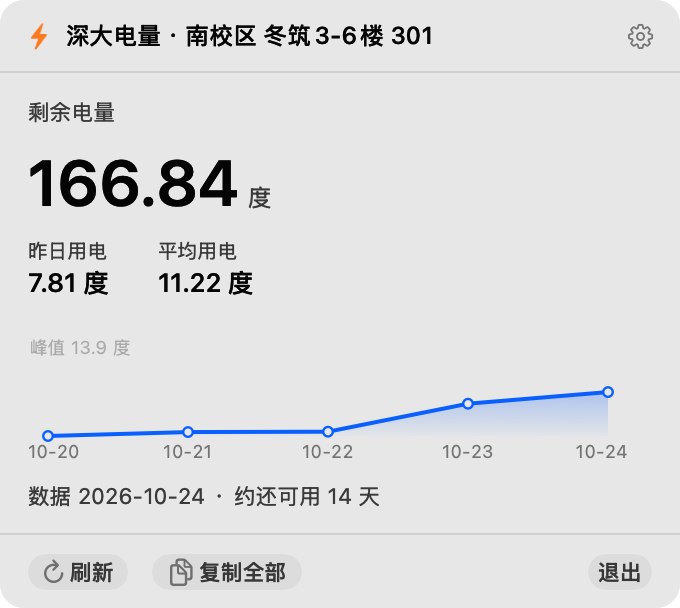

# 深大电量 · macOS 版

深圳大学宿舍电表查询，做成一个常驻菜单栏的小工具：点一下菜单栏图标就弹出一张卡片，
显示剩余电量、昨日用电、近 5 天折线图、预估还能用几天。



原生 AppKit + Swift 写的，**不依赖任何第三方库**，装好 Command Line Tools 就能编译。

---

## 为什么有 macOS 版

上游的 [hongsawd/szu-battery-inquiry](https://github.com/hongsawd/szu-battery-inquiry) 是 Windows 版：
PowerShell 5.1 + WPF 自绘界面 + `System.Windows.Forms.NotifyIcon` 托盘 + Win32 `RegisterHotKey` 全局热键。
这些东西在 macOS 上一概不存在，脚本连加载都过不去（`%LOCALAPPDATA%` 为 null、GBK 代码页没注册）。

所以这个仓库是**用 Swift 重写**的 macOS 原生版本，数据来源和计算口径跟原版完全一致
（连四舍六入五成双的细节都对齐了）。

## 跟 Windows 版的对应关系

| 功能 | Windows 版 | macOS 版 |
|---|---|---|
| 常驻方式 | 托盘图标 + VBS 隐藏启动 | 菜单栏图标（`LSUIElement`，不占 Dock） |
| 卡片界面 | WPF 自绘 | AppKit + 自绘折线图 |
| 卡片弹出 | 全局热键 / 桌面快捷方式 | 全局热键（Carbon `RegisterEventHotKey`，**不需要辅助功能权限**）/ 点菜单栏图标 |
| 托盘右键菜单 | 自绘 WPF 菜单 | 原生 `NSMenu` |
| 开机自启 | 启动文件夹快捷方式 | `~/Library/LaunchAgents` + `launchctl` |
| 主题 | 深色 / 浅色 / 跟随系统 | 同（`NSApp.appearance`） |
| 低电量预警 | 卡片顶部红色横幅 | 同（菜单栏图标变警告符号 + 卡片横幅） |
| 本地历史 | `history.csv` | 同（同样格式） |

## 环境要求

- macOS 13 Ventura 及以上
- **校内网** —— 宿舍电控系统是 `192.168.84.3` 内网地址，校外 / 手机热点查不到
- 编译需要 Xcode Command Line Tools（`xcode-select --install`），**不需要完整 Xcode**

## 装

### 方式一：下载 Release（最省事）

到 [Releases](https://github.com/superfansizhe-beep/szu-power-mac/releases) 下载 `szu-power-mac-v1.0.0.zip`，
解压后把 `深大电量.app` 拖进「应用程序」。

> ⚠️ 这个包是 ad-hoc 签名（没走苹果公证），第一次打开会被 Gatekeeper 拦一下：
> 右键点 `深大电量.app` → **打开** → 再点「打开」就行。
> 想省事就在终端跑一次：`xattr -dr com.apple.quarantine /Applications/深大电量.app`

### 方式二：自己编译（推荐开发者）

```bash
git clone https://github.com/superfansizhe-beep/szu-power-mac.git
cd szu-power-mac
./scripts/build-app.sh
```

产物在 `dist/深大电量.app`，拖进「应用程序」文件夹就能用。

### 方式三：只跑命令行的

```bash
swift build -c release
.build/release/SZUPower --query 南校区 冬筑3-6楼 301
```

## 用法

1. 第一次打开会弹设置窗口：选**校区** → 选**楼栋**（列表实时从服务器拉）→ 填**房间号** → 设个**快捷键** → 保存
2. 菜单栏出现一个 ⚡ 图标，点它弹出卡片
3. 设了快捷键的话，按快捷键直接弹卡片（默认 `Ctrl + Alt + E`）
4. 右键菜单栏图标 → 立即查询 / 设置 / 开机自启 / 退出

卡片上能直接选中数字复制，点「复制全部」会得到一段纯文本：

```
深大电量 · 南校区 冬筑3-6楼 301
剩余 166.84 度
昨日用电 7.81 度
平均用电 11.22 度
数据 2026-10-24 · 约还可用 14 天
```

### 命令行模式

```bash
# 用已保存的配置查一次
SZUPower --dump

# 临时查一次，不用先配置
SZUPower --query <校区> <楼栋> <房间号>

SZUPower --help
```

查不到数据基本都是两个原因：不在校内网，或者楼栋名 / 房间号不对。

## 数字怎么算的

| 指标 | 口径 |
|---|---|
| 剩余电量 | 电控系统最新的「剩余电量(度)」 |
| 昨日用电 | 最新一天的总用电量 − 前一天的总用电量 |
| 平均用电 | 近 30 天逐日用电的均值；先剔掉电表归零（差值 ≤ 0）和异常跳变（> 80 度/天） |
| 约还可用 | 剩余电量 ÷ 平均用电，向下取整 |
| 折线图 | 只画最近 5 天，不参与平均值计算 |

一次查询要抓两段：电控系统的 `selectList.do` 单次最多返回 20 条记录，
所以脚本先取「最近 20 天」，再补「往前 15 天」，按日期合并去重，凑出一个月。

逐日用电是相邻两天「总用电量」相减，再按间隔天数摊平（间隔超过 3 天的记录直接丢掉）。

## 原理

数据来自学校的 SIMS 电控网上查询系统，公开表单接口，没有登录态：

1. `GET /cgcSims/login.do?task=station&client=<校区IP>` —— 拿该校区楼栋列表（校区 → 内网 IP）
2. `POST /cgcSims/login.do` —— 用楼栋 id + 房间号换出系统内部的 `roomId`
3. `POST /cgcSims/selectList.do` —— `type=2` 查用电记录，返回 HTML 表格（**GBK 编码**）

返回的是 GBK，所以楼栋名和房间号在拼 URL 时也得按 GBK 做百分号转义，
不能直接用 `addingPercentEncoding`（那个是按 UTF-8 转的，中文会错）。

## 文件放哪

```
~/Library/Application Support/szu-power/
├── config.json     配置（校区 / 楼栋 / 房间 / 快捷键…）
├── cache.json      上次查到的结果，冷启动秒开
└── history.csv     历史流水
```

`history.csv` 格式跟 Windows 版一致：

```
query_time,data_date,remain,used_total,bought_total,avg_per_day,days_left
```

## 目录结构

```
Sources/SZUPower/
├── AppDelegate.swift          入口、菜单栏图标、托盘菜单
├── AppModel.swift             全局状态：配置 / 数据 / 加载状态
├── CardPopoverController.swift  卡片浮层
├── UsageChartView.swift       自绘折线图
├── SettingsWindowController.swift 设置窗口
├── SimsClient.swift           电控系统 HTTP 客户端（GBK 编解码）
├── PowerService.swift         查询编排 + 指标计算
├── Store.swift                配置 / 缓存 / 历史落盘
├── HotKeyManager.swift        全局快捷键（Carbon）
├── LaunchAgent.swift          开机自启
├── CLIMode.swift              命令行模式
└── DebugRender.swift          离屏渲染调试

scripts/
├── build-app.sh               打包 .app
├── make-icon.swift            生成图标
└── make-zip.py                打 zip（保证 UTF-8 文件名 + 权限位）
```

## 开发

```bash
swift build                 # 编译
swift run                   # 跑起来
./scripts/build-app.sh      # 打包 .app
```

两个调试用的小开关：

```bash
# 启动就自动弹出卡片（方便配合截图工具）
SZU_OPEN_CARD=1 ./.build/debug/SZUPower

# 把卡片离屏渲染成 PNG（没有显示器 / CI 环境下做视觉检查）
SZU_RENDER_CARD=/tmp/card.png ./.build/debug/SZUPower
SZU_APPEARANCE=light|dark SZU_RENDER_CARD=/tmp/card.png ./.build/debug/SZUPower
```

## 免责

非官方工具，只读查询自己宿舍的电表数据，不改任何东西。系统接口哪天变了，卡片会变成「查询失败」并给出原因。

## 致谢

- 上游 Windows 版：[hongsawd/szu-battery-inquiry](https://github.com/hongsawd/szu-battery-inquiry)（MIT）
- 数据来源：深圳大学 SIMS 电控网上查询系统

## License

MIT
